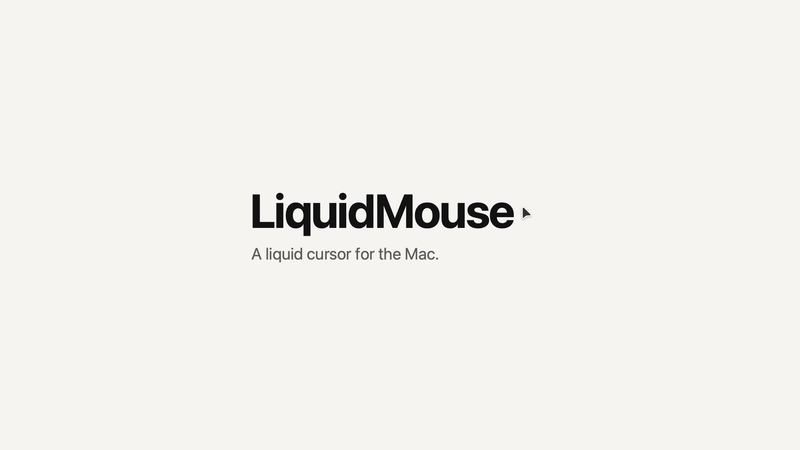
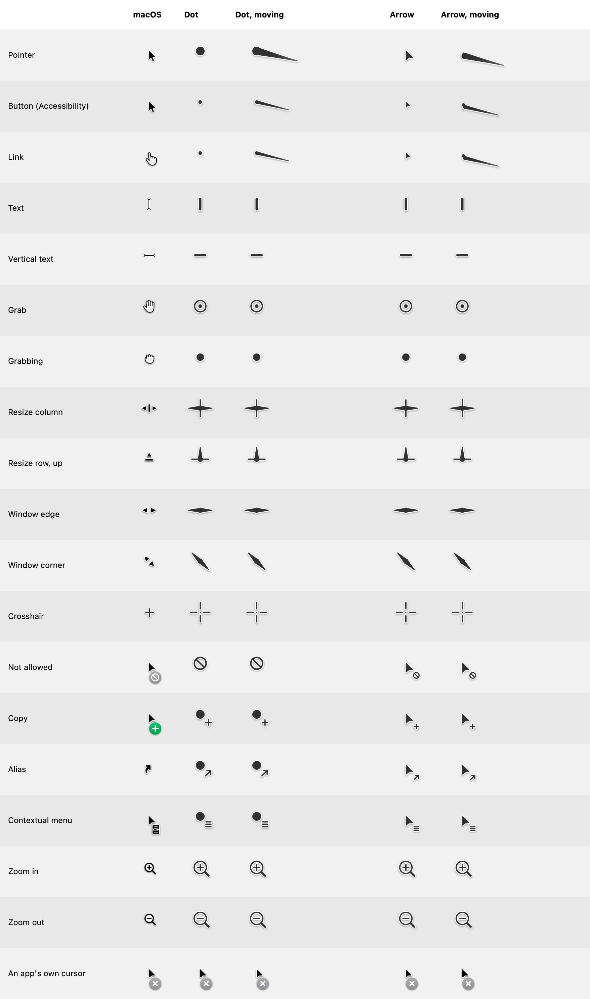

<p align="center"></p>

<h1 align="center">LiquidMouse</h1>

<p align="center">A liquid cursor for the Mac.<br><a href="#in-italiano">In italiano ↓</a></p>



Since I started using computers, the mouse cursor has always been the same: at most its little icon changes.
I imagined one you could shape instead, and LiquidMouse is that idea: a cursor made of liquid. Pick a dot or an
arrow: it stretches into a tail as you move, splashes when you click and gathers back into its shape when you
stop. Over text, links, window edges and anything you can drag it takes the matching shape, so the cues you rely
on are still there.

> [!NOTE]
> **0.9.0 is a beta.** It is free and open source, but not yet notarized by Apple, so macOS asks you to confirm
> the first launch. It relies on undocumented macOS calls, so a system update can break it until LiquidMouse is
> updated.

## Features

- **Two forms**: a round dot, or an arrow that melts into its tail as it moves.
- **A shape for every job**: a bar over text, spindles on edges you can resize, a ring for what you can grab,
  a cross for precise tools. It shrinks over links and, with the Accessibility permission, over buttons.
- **Stays out of the way**: custom cursors it does not recognize stay native, games keep their own cursor, and
  it hides while you type.
- **Adjustable**: size, color, trail length and speed, bounce, click splash, when to hide.
- In English and Italian.



## Install

Requires macOS 15 or later, on Apple silicon or Intel.

1. Download the zip of the latest version from [Releases](../../releases) and open it.
2. Drag **LiquidMouse** into **Applications** and open it.
3. macOS blocks the first launch because the app is not notarized. Open **System Settings → Privacy & Security**,
   scroll down, click **Open Anyway** and confirm.
4. A drop appears in the menu bar: click it for the settings.

To make the cursor precise over buttons too, click **Open System Settings** under **Buttons** and turn LiquidMouse
on in the Accessibility list. It only asks what kind of element is under the pointer, never what it contains
([Privacy](PRIVACY.md)).

To update, quit LiquidMouse and replace the copy in Applications; settings are kept. If buttons are no longer
recognized afterwards, remove LiquidMouse from the Accessibility list and add it again, or reset its permission:

```sh
tccutil reset Accessibility io.github.beniaminonardone.LiquidMouse
```

To uninstall, quit it from the menu-bar drop and delete it from Applications. `defaults delete
io.github.beniaminonardone.LiquidMouse` erases its settings too.

## Known limits

- Tested mostly on macOS 27, and on Apple silicon Macs only. It is built for Intel too, but has not been run on
  one yet. Reports from other Macs are very welcome.
- The undocumented calls rule out the Mac App Store, and a macOS update can break it.
- Button detection depends on what each app exposes to Accessibility, so it does not work everywhere.
- Games that do not declare themselves as games to macOS have to be added under **Use original cursor**.
- Drawing stops when the cursor is still. On an M2 Pro the app uses about 1% of one CPU core at rest and 10% while
  moving; battery life has not been measured.

## How it works

LiquidMouse hides the system cursor and draws its own in a transparent, click-through window above everything,
one per screen. It follows the pointer at every refresh of the display and sleeps while the mouse is still. To
know what the pointer is about to do it reads the image of the system cursor, which apps keep setting as usual;
with the Accessibility permission it also asks what kind of element is under the pointer.

macOS offers no public way for an app to hide the cursor while other apps are in front, so LiquidMouse uses a few
undocumented WindowServer calls, looked up when it starts. Two are essential. The others switch themselves off
if a macOS update removes them, instead of breaking the app:

| Call | What for | Without it |
| --- | --- | --- |
| `CGSMainConnectionID` | Name the app's connection to the WindowServer, for the call below | LiquidMouse cannot run |
| `CGSSetConnectionProperty` (`SetsCursorInBackground`) | Hide the system cursor while other apps are in front | LiquidMouse cannot run |
| `CGCursorIsVisible` | Notice at once when an app shows the cursor again, and hide it | The normal cursor comes back beside ours whenever an app shows it |
| `CGSCurrentCursorSeed` | Know the moment an app changes the cursor | The cursor is read ten times a second instead |
| `SLSSetDockCursorOverride` | Keep the system cursor hidden over the Dock | The normal cursor shows over the Dock |
| `SLSGetCursorScale` | Follow the pointer size set in Accessibility | The size setting is used as it is |
| `SLSIsScreenWatcherPresent` | Leave our cursor out of screenshots but keep it in recordings and screen sharing | Our cursor also shows in screenshots |

It steps aside whenever the system is in front (lock screen, screensaver, password and permission prompts), which
it notices through an undocumented session key and notifications. A separate watchdog thread gives the normal
cursor back if the main thread stops responding.

## Build from source

Xcode is not needed: the Command Line Tools with Swift 6.2 or later are enough. There are no dependencies.

```sh
Scripts/build-app.sh --install   # builds the app and installs it in /Applications
Scripts/test.sh                  # runs the tests
```

The code is in `Sources/LiquidMouse`. Good places to start: `Engine.swift` (the frame loop), `LiquidBody.swift`
(the physics of the drop), `CursorHider.swift` (hiding the system cursor, and the watchdog) and
`WindowServer.swift` (the undocumented calls). Bug reports and pull requests are welcome: see
[CONTRIBUTING](CONTRIBUTING.md).

## License

© 2026 Beniamino Nardone. LiquidMouse is free software under the [GNU General Public License, version 3](LICENSE):
you can use it, study it, change it and share it, as long as what you share stays under the same license.

---

## In italiano

Da quando uso i computer il cursore del mouse è sempre lo stesso: al massimo cambia l'iconcina. Ho immaginato di
renderlo malleabile, e LiquidMouse è quell'idea: un cursore fatto di liquido, che si allunga in una scia mentre lo
muovi, schizza quando fai clic e prende la forma giusta su testo, link e bordi delle finestre.

È una beta gratuita e open source, per macOS 15 o successivo. Scarica lo zip da [Releases](../../releases),
trascina **LiquidMouse** in **Applicazioni** e aprilo. La prima volta macOS lo blocca perché non è notarizzato:
apri **Impostazioni di Sistema → Privacy e sicurezza**, premi **Apri comunque** e conferma. Le impostazioni sono
nella goccia nella barra dei menu, e l'interfaccia è in italiano se il Mac è in italiano.

Segnalazioni e proposte sono benvenute anche in italiano nelle [Issues](../../issues/new/choose).
